# Training Timer

An offline workout timer for Android, made for an office worker who runs and climbs. Build workouts from your own exercise library, time them or count reps, add weights, repeat them in cycles, see the equipment you need, and get reminded when it's time to train or to breathe.

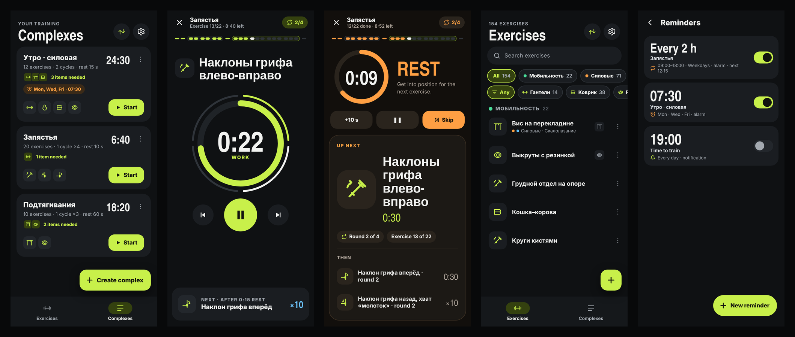

No account, no ads, no internet connection. All data stays on the phone.

> The pictures in this README come from the app's design mockups (in the project's design canvas). Exercise names and numbers are examples, and small details can differ from the current build.

## Contents

- [Exercise library](#exercise-library) — exercises, categories, equipment, search and filters, left and right sides, built-in library
- [Complexes](#complexes) — builder, cycles, weights, cards, overview before the start, built-in complexes
- [Workout](#workout) — timer, progress line, rounds, reps sets, rest, breathing reminders, signals, finish
- [Reminders](#reminders) — at a time or repeating, full-screen alarm
- [Settings](#settings), [Import and export](#import-and-export)
- [Install](#install), [Built-in content](#built-in-content), [Import file format](#import-file-format), [Build](#build)

## Exercise library

### Exercises
Each exercise has a name (up to 60 characters) and an icon: 90+ line icons in one style, or a picture from the gallery. The **Exercises** tab lists them grouped by category, with small icons of the equipment each one needs. Tap one to edit it; the ⋮ menu edits or deletes it. **+** adds a new one; the round buttons at the top open import/export and Settings.

| 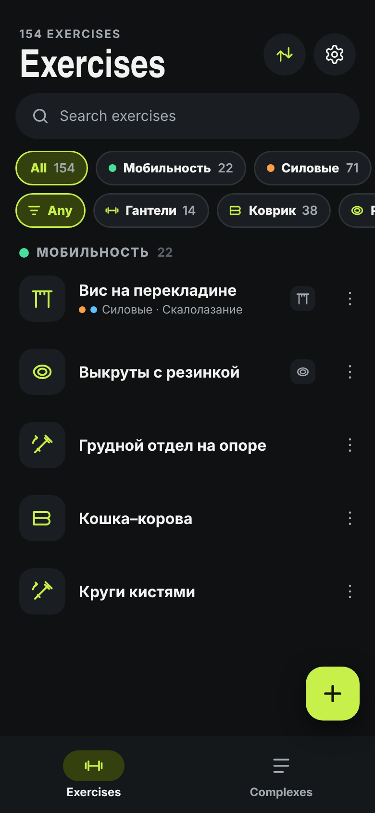 | 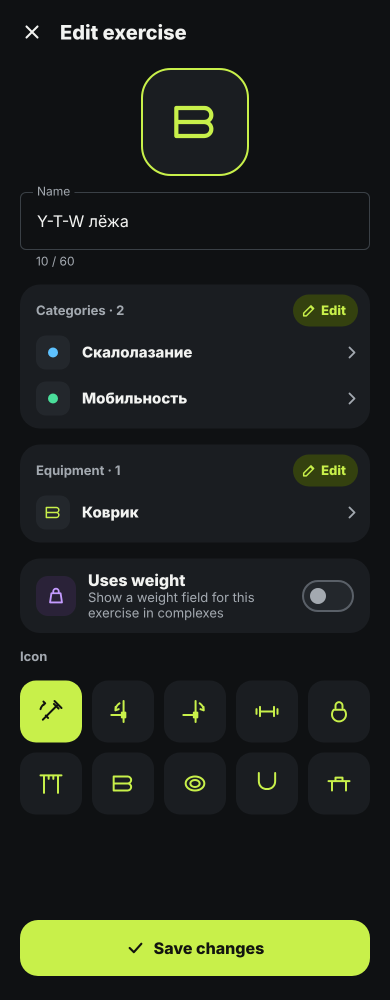 |
|---|---|

### Categories
Colour-coded groups such as Мобильность, Силовые, Растяжка, Кардио and Скалолазание. An exercise can be in several categories or none. In the exercise editor the chosen categories are a short list; **Edit** opens all categories with a search and **New category**. Rename, recolour, reorder (hold ⠿ and drag) and delete them in **Settings › Categories** — deleting keeps the exercises.

| 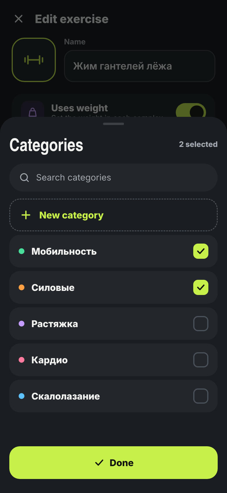 | 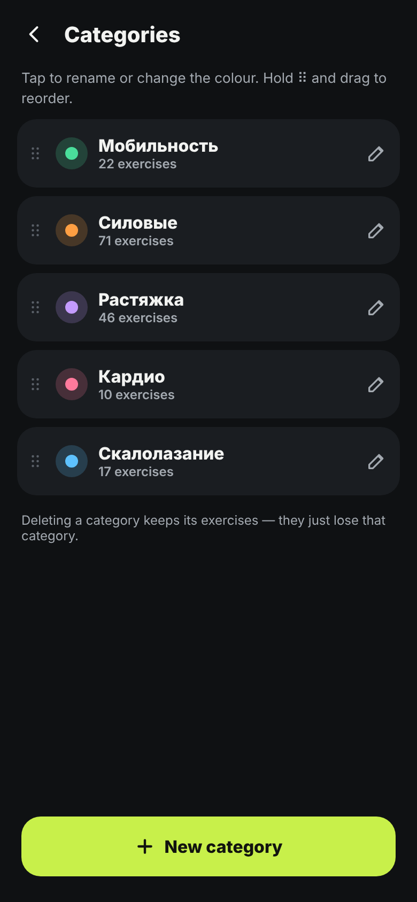 |
|---|---|

### Equipment
Dumbbells, a mat, a pull-up bar, a fingerboard… each with its own icon (17 to choose from). In the exercise editor the exercise's equipment is a short list; **Edit** opens all equipment with a search and **New equipment** (name + icon). Tap an item to edit it: name, icon and every exercise that uses it — tap one to open it. **Settings › Equipment** lists everything with the number of exercises.

| 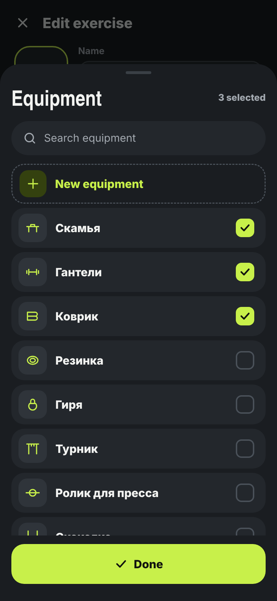 | 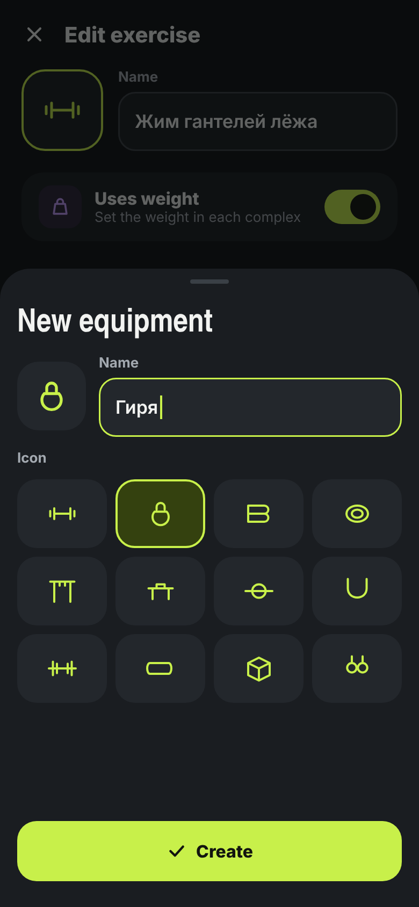 | 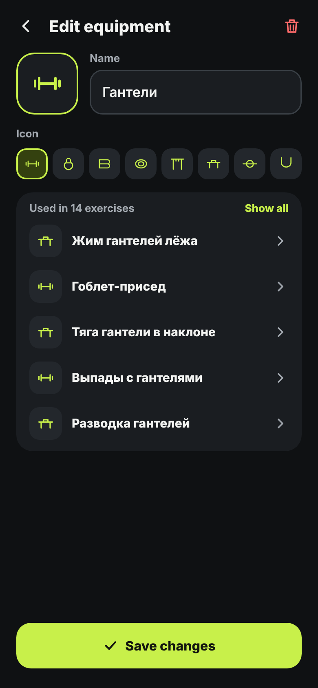 |
|---|---|---|

### Search and filters
Search by any part of the name, then narrow down by category and by equipment — two chip rows that work together (the chips show counts; tap a selected chip again or its ✕ to clear it). The same search and filters are in every exercise picker of the complex editor.

| 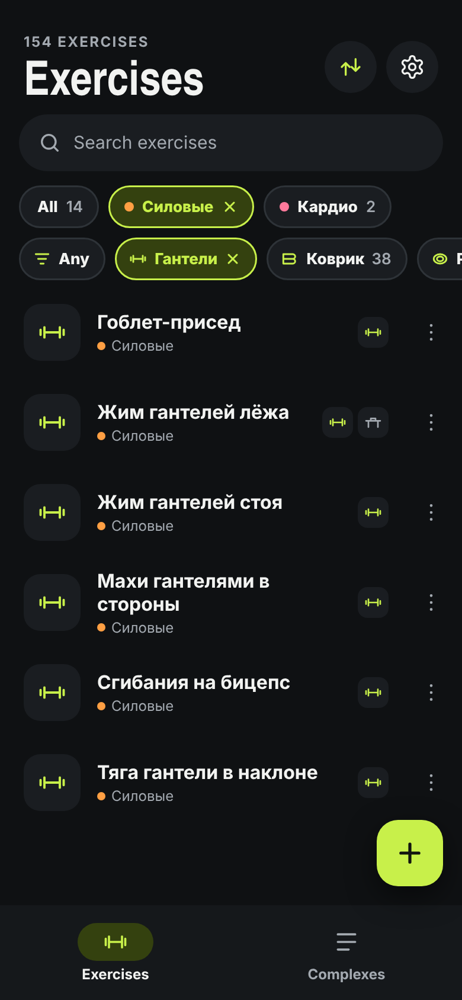 | 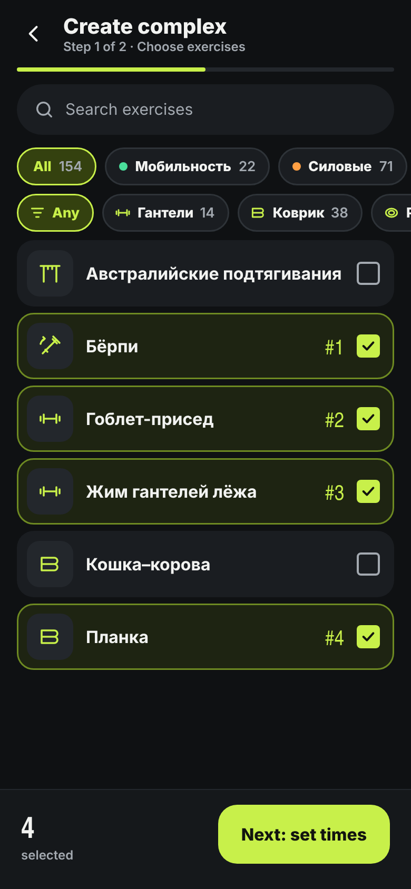 |
|---|---|

### Left and right
Exercises done on one side always come as two: a right and a left version (*Голубь, правая нога* / *Голубь, левая нога*). Complexes do them one after the other, so each side gets the same time and you never have to switch sides yourself.

### Uses weight
Mark exercises done with dumbbells, a kettlebell or a barbell as **Uses weight**; complexes then get a weight field for them.

## Complexes

### Building a complex
1. **Create complex** › pick exercises (search, category and equipment filters; the order you tick them is the order they run).
2. Set each one to **Time** (−/+ in 5-second steps, or tap to type) or **Reps** (a target count like ×12).
3. Set the rest between exercises. Hold ⠿ and drag to reorder; when you drag near the top or bottom edge the page scrolls by itself.

The exercise menu has **Move into new cycle**, move into an existing cycle, move out of a cycle and **Remove from complex**. The total time updates live (reps sets are counted separately — they take as long as you need).

### Cycles
A group of exercises repeated N rounds, with its own optional rest. The cycle menu has **Copy cycle** (same exercises, rounds and rest, right below) and **Remove cycle**.

### Weights
Set one weight for a set, or in a cycle a weight **per round**. **Fill all rounds** fills them from a start weight and a step (e.g. 10 kg, +2 kg); then change any round by hand. A cycle can mix weighted and bodyweight exercises. kg or lb is chosen in Settings.

| 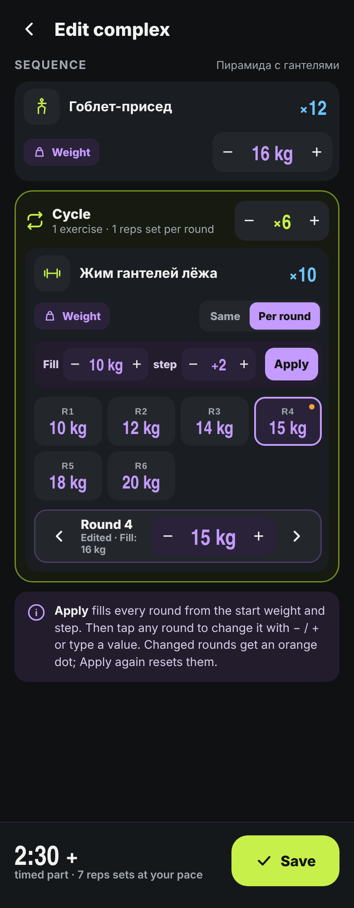 | 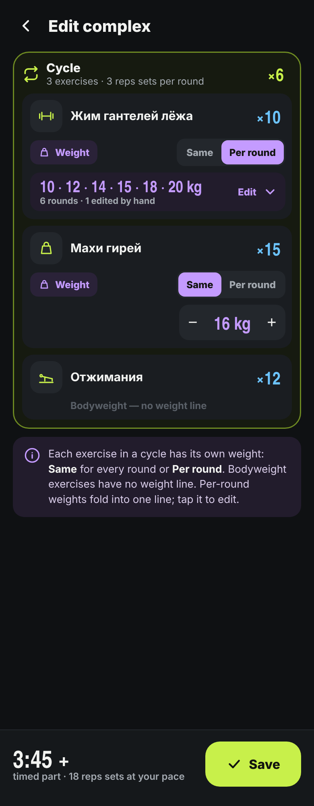 |
|---|---|

### Complex cards
The **Complexes** tab shows each complex with its total time, its exercises as icons, a stack of the equipment it needs (*3 items needed*) and its reminder. Hold and drag cards to reorder them.

### Overview before the start
**Start** opens the complex first: total time, number of sets and cycles, **You'll need** — every piece of equipment with how many exercises use it — and all exercises in order with their time or reps. **Start workout** begins; the pencil edits the complex.

| 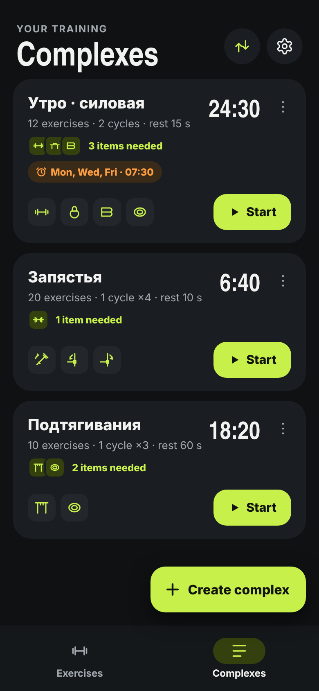 | 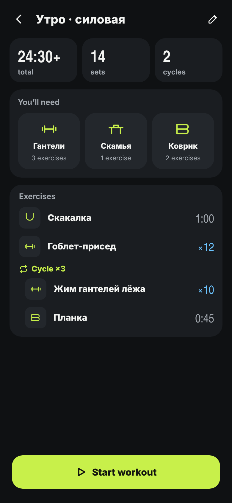 |
|---|---|

## Workout

### The timer
A large ring counts down each timed set. The exercise icon and name sit on the left in a fixed three-line block, so the timer keeps one size and place for the whole workout; it only leaves room for the round ring, weight and reps controls the workout actually uses. Names longer than three lines show a ⌄ — tap the name to read it in full in a card over the timer, tap again to close. The **Next** card at the bottom shows what comes after the rest.

| 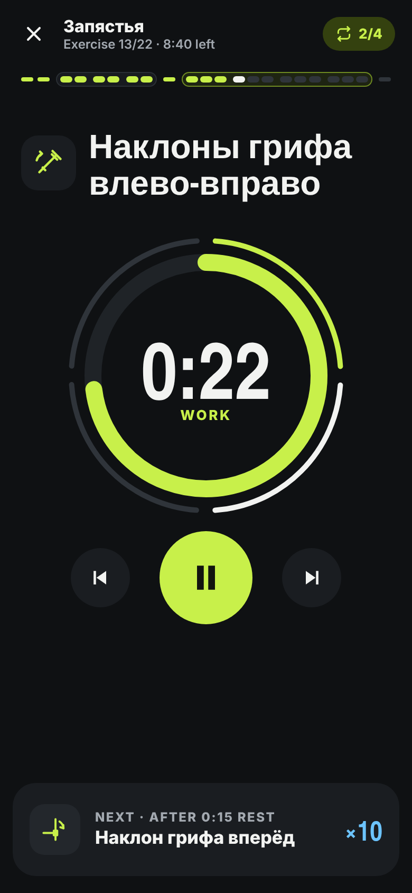 | 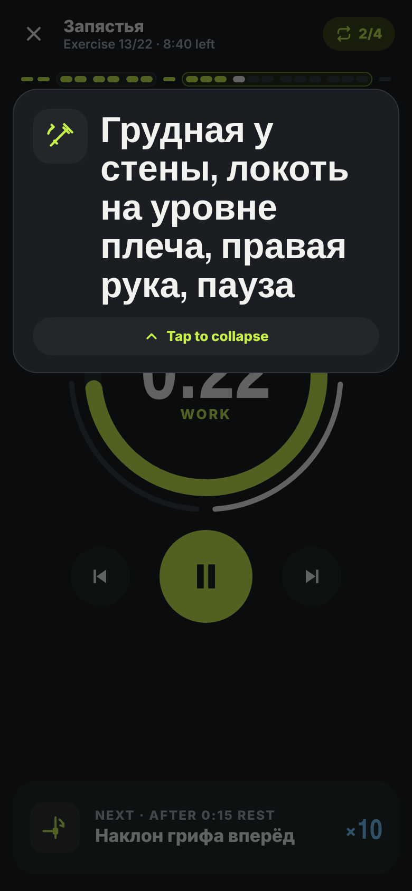 |
|---|---|

### Progress line with cycles
Every set is a segment; cycles sit on their own band and their rounds are spaced apart; the current set is white. In big complexes the block you're in keeps per-set detail and takes at least half the line, while other cycles shrink to one segment per round (or per cycle).

### Rounds
In a cycle a **round ring** around the timer has one segment per round — done rounds lime, the current one white — and a *2/4* badge sits in the header. When a new round starts the next segment draws in, *Round 2 of 4* appears on the timer, the badge flashes, the screen edges glow lime for a moment, and a distinct triple beep and buzz play (only between rounds, not when a cycle starts).

| 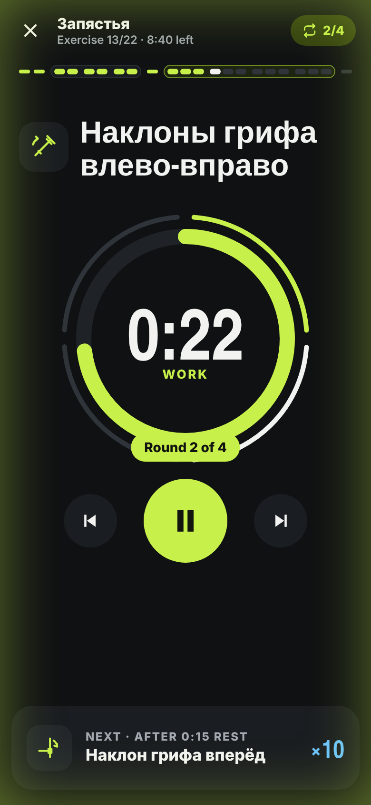 |
|---|

### Reps sets and weights
A reps set shows the target count and a small stopwatch; tap **Done** (between previous and skip) when you finish. A weighted set shows its planned weight (and the round), also in the Next card, on the rest screen and in the notification.

| 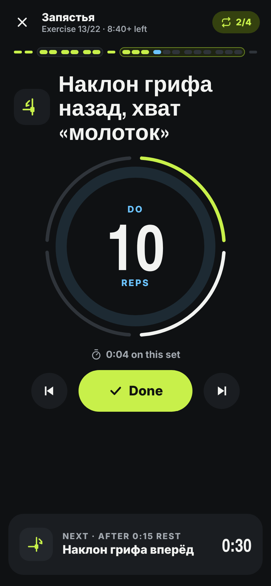 | 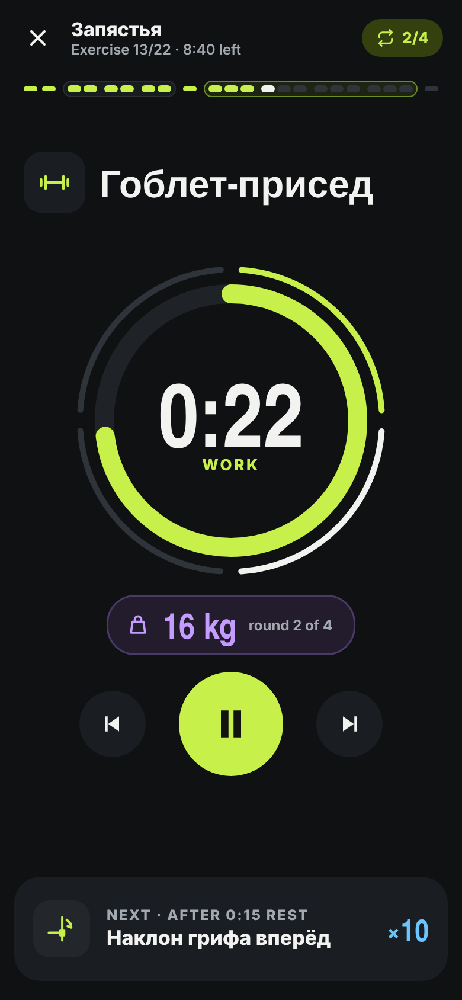 |
|---|---|

### Rest
The rest screen counts down in orange and shows the next exercise large — with its own time or reps — then the two after it. **+10 s** extends the rest (the ring follows), **Skip** ends it.

### Breathing reminders
Optional (Settings). During exercises — not rests — every N seconds (10–180 s) the timer gets a soft blue glow and *WORK* turns into *BREATHE* for two seconds, with the sound of a wave rolling in and out and a buzz that swells and fades.

| 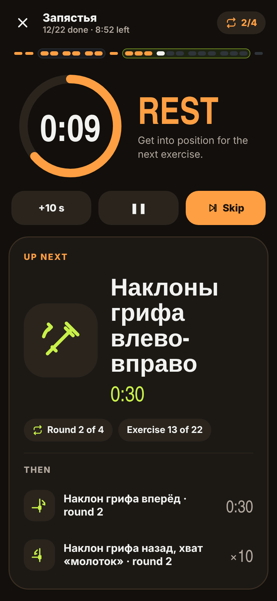 | 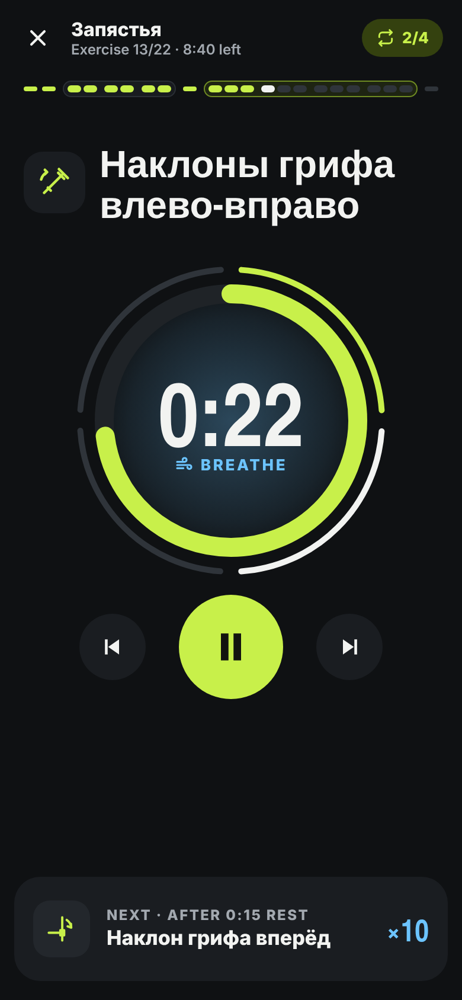 |
|---|---|

### Signals and the lock screen
Optional "get ready" countdown before the first exercise (0–15 s). Beeps in the last 3 seconds and at every switch, vibration on each switch (both can be turned off; beeps follow the media volume). The timer keeps running with the screen locked, and pause, skip, Done and end are in the notification. The screen stays on during a workout. Pause, previous and skip are always on the screen.

### Finish
The finish screen shows the real time and the number of sets. If the workout came from a repeating reminder, it also says when the next reminder will ring.

| 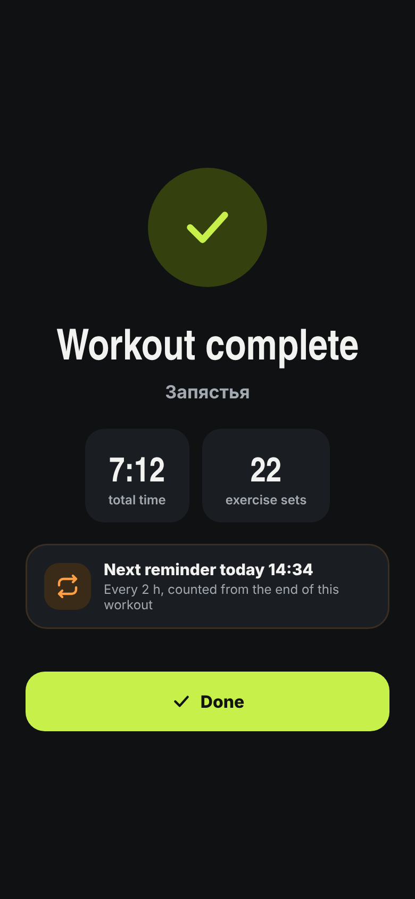 |
|---|

## Reminders

### At a time
Any number of reminders, each with a time and days (every day, weekdays, chosen days, or once). Remind about a specific complex — start it right from the reminder — or just send a "time to train" nudge with your own message. **Notification**: a banner with Start and Snooze. **Alarm**: rings full screen over the lock screen, even in silent mode, with your chosen sound; Start workout, Snooze (5–30 min) or Dismiss; if nobody reacts in 5 minutes it snoozes itself. One-time reminders switch themselves off after they ring.

### Repeat every X between two times
Choose **Repeat**, an interval (15 min – 6 h, with quick picks) and **From** / **Until**, e.g. every 2 h from 09:00 to 18:00 on weekdays. Rings sit on a grid from *From* (09:00, 11:00, 13:00 …), also when you switch it on in the middle of the window; nothing rings at or after *Until*. The editor previews today's times. Start or Snooze on a repeating reminder restarts the step when the workout (or the snooze) ends.

| 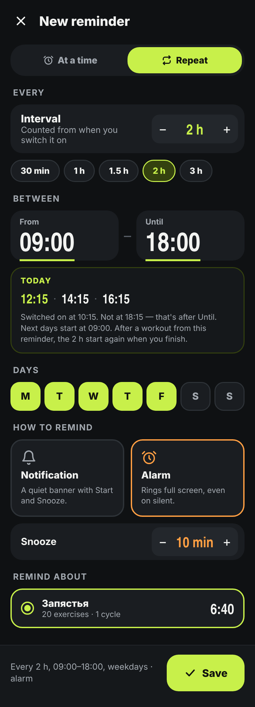 | 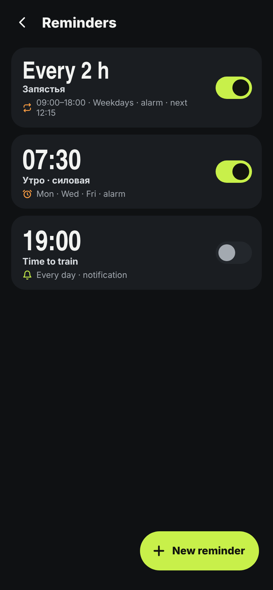 | 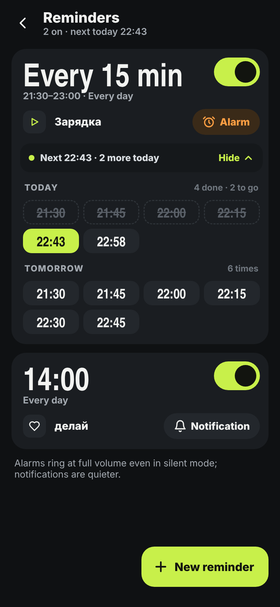 |
|---|---|---|

### Show times
A repeating reminder's card shows the next ring and how many are left today; **Show times** opens today's times (done ones struck through, the next one in lime) and the next day's.

### Full-screen alarm
The alarm shows over the lock screen. **Start workout** starts the workout straight away — even while the phone asks for your fingerprint, so it's running when you unlock. Alarms are set again after a reboot, an app update or a clock change.

| 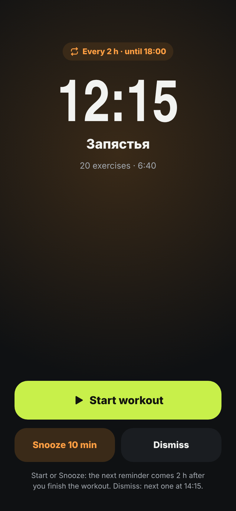 | 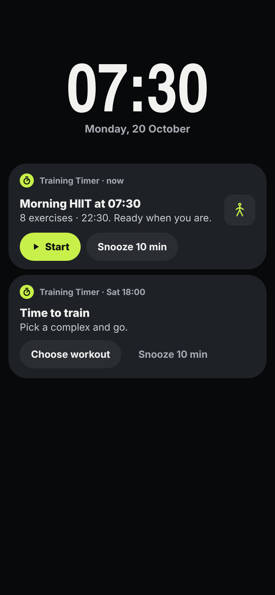 |
|---|---|

## Settings

- **Library:** Categories and Equipment
- **Reminders**
- **Workout start:** countdown before the first exercise
- **Units:** kg or lb
- **Workout signals:** beeps, vibration, breathing reminders and how often

| 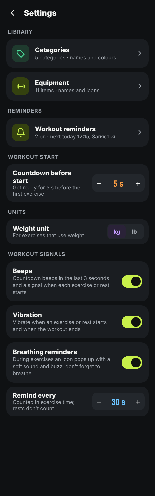 | 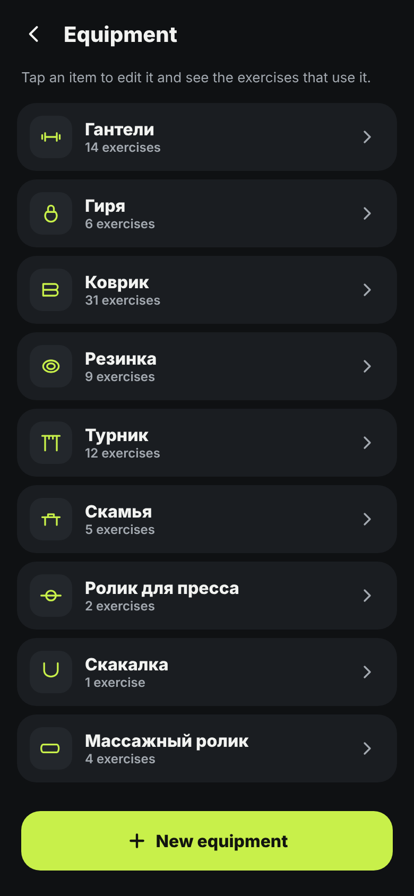 |
|---|---|

## Import and export

Import exercises, categories, equipment and complexes from a JSON file; names that already exist are skipped and a summary lists what was added, skipped or not readable. Exercises a complex needs but your library doesn't have are created with a "?" icon. Export all exercises, one complex, all complexes, or a full backup. The format is below.

| 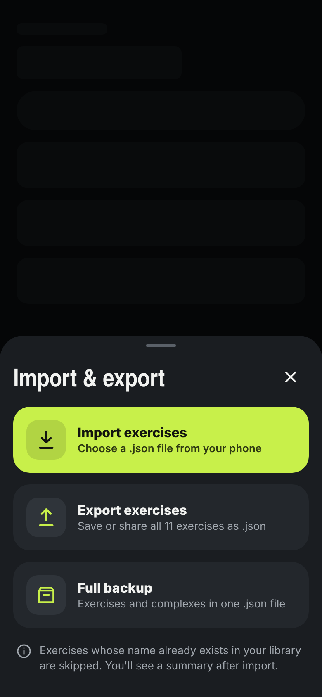 | 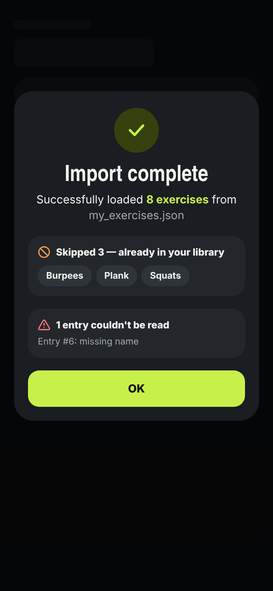 |
|---|---|

## Install

Every push to `main` is built by GitHub Actions to check it compiles. New versions are published on the [Releases](../../releases) page when a release is started by hand (Actions › Build APK › Run workflow).

1. Open **Releases** on your Android phone and download the latest `TrainingTimer-*.apk`.
2. Open the file. The first time, Android asks you to allow installing apps from your browser or file manager.
3. Installing a newer version over the old one keeps all your data.

Requires Android 8.0 or newer.

### Permissions

| Permission | Why |
|---|---|
| Notifications | Workout controls on the lock screen and reminders. Asked when you start a workout or save a reminder |
| Exact alarms | Reminders fire on the minute. Granted automatically (Android 13+: `USE_EXACT_ALARM`) |
| Full-screen alarms | An alarm opens over the lock screen. On Android 14+ you may need to allow it; the Reminders screen shows an **Allow** button if so |
| Run at startup | Sets reminders again after the phone restarts |
| Foreground service, wake lock, vibration | Keep the timer and an alarm running with the screen off |

The app has no internet permission.

## Built-in content

One-sided exercises always come as a right and a left version (e.g. *Голубь, правая нога* and *Голубь, левая нога*), and complexes do them one after the other, so each side gets the same time.

On first launch the app adds:

- **Categories:** Мобильность (mobility), Силовые (strength), Растяжка (stretching)
- **Exercises:** joint warm-up, shoulder mobility, bodyweight strength, stretching and wrist exercises, each with its own icon
- **Climbing:** fingerboard hangs (open and half-crimp grip, 7/3 repeaters), lock-offs, Frenchies, offset pull-ups, toes to bar, hollow body, Y-T-W, finger extensions, band pull-aparts and external rotations, frog stretch — in a *Скалолазание* category, with a *Фингерборд* equipment item
- **Classics:** burpees, jumping jacks, high knees, mountain climbers, jump rope, planks and side planks, crunches, bicycle, Russian twist, flutter kicks, superman, dead bug, bird-dog, lunges, sumo squats, wall sit, calf raises, step-ups, push-up variations, bench dips, dumbbell and kettlebell basics (weighted) — with a *Кардио* category
- **Растяжка** complex: 51 stretches in order (≈32 min, 30 s each, 5 s rest), with new ones — child's pose, thread the needle, happy baby, cross-body arm, triceps, shin and toe stretches, ankle circles, legs up the wall
- **Скалолазание: сила** (≈32 min + rep sets): joint warm-up and scapular pull-ups, fingerboard hangs 5×10 s, a pulling cycle (pull-ups, 90° lock-offs, toes to bar) ×3, an antagonist cycle (push-ups, band pull-aparts, external rotations, finger extensions) ×3 and a core cycle (hollow body, Y-T-W, side planks) ×2
- **Скалолазание: заминка** (≈15 min): forearm and wrist stretches, chest, cross-body and triceps, child's pose and thread the needle for the lats and upper back, frog, pigeon, hip-flexor lunge, forward fold, neck, legs up the wall
- **Зарядка: офис, бег, скалы** (≈13 min + 3 rep sets): neck and chin tucks, thoracic mobility (cat–cow, thoracic extension, thread the needle), shoulder opening (band dislocates, wall slides, band pull-aparts, Y-T-W, chest stretches at two heights), then hips, leg swings, ankles and glute bridges for running
- **Запястья: сила**: warm-up and stretch, then 3 rounds of wrist curls and extensions, bar rotations and radial/ulnar tilts, 2 rounds of finger rolls and band finger extensions, and a stretch to finish
- **Разминка на работе** (≈8 min + rep sets): neck, joints, a hang and scapular pull-ups on the wall bars, inverted rows and dips, goblet squats and Romanian deadlifts with dumbbells, shoulder and hip-flexor stretches
- **Бег: сила ног**: 3 rounds of goblet squats, reverse lunges, Romanian deadlifts, single-leg bridges and calf raises; 2 rounds of band side steps, single-leg balance, eccentric calf raises and side planks
- **Бег: заминка** (≈15 min): calves, quads, hamstrings, hip flexors, pigeon, butterfly, forward fold, twists, shins, happy baby, legs up the wall
- **Pull-ups:** wide, close, chin-up, neutral grip, inverted (Australian), negative, band-assisted, dead hang, scapular, L-sit, archer and weighted
- **Complexes:** five base workouts that show every feature — single exercises, several cycles, repeats and per-cycle rest:

| Complex | Sets | Duration | Highlights |
|---|---|---|---|
| Утренняя зарядка (morning warm-up) | 14 | ~7 min | joint circles, a ×2 cycle |
| Силовая круговая (strength circuit) | 19 | ~12 min + reps | two cycles (×3 and ×2) with their own rests, push-ups and pull-ups in reps |
| Плечи: мобильность (shoulder mobility) | 16 | ~13 min | ×3 band cycle, left/right pairs |
| Растяжка всего тела (full-body stretch) | 22 | ~14 min | neck cycle with 3 s rest, side-by-side stretches |
| Запястья и предплечья (wrists and forearms) | 15 | ~10 min | ×3 and ×2 cycles |

The built-in programs live in [`app/src/main/assets`](app/src/main/assets) and use the same format as import files.

## Import file format

```json
{
  "version": 1,
  "categories": [
    { "name": "Растяжка", "color": "#C49BFF" }
  ],
  "equipment": [
    { "name": "Гантели", "icon": "dumbbell" }
  ],
  "exercises": [
    { "name": "Burpees", "icon": "jump", "categories": ["Силовые"] },
    { "name": "Side plank", "icon": "plank" },
    { "name": "Goblet squat", "icon": "squat", "usesWeight": true, "equipment": ["Гантели"] }
  ],
  "complexes": [
    {
      "name": "Morning HIIT",
      "rest": 15,
      "items": [
        { "exercise": "Burpees", "time": 30 },
        { "exercise": "Push-ups", "reps": 12 },
        { "exercise": "Goblet squat", "reps": 12, "weight": 16 },
        { "cycle": { "repeats": 3, "rest": 10, "items": [
          { "exercise": "Side plank", "time": 45 },
          { "exercise": "Goblet squat", "reps": 10, "weights": [12, 14, 16] }
        ] } }
      ]
    }
  ]
}
```

- All sections are optional; a plain list of exercise names is also accepted.
- `rest` and `time` are in seconds. A cycle's `rest` is optional; without it the complex's rest is used.
- Use `reps` instead of `time` for a set counted in repetitions; it ends when you tap Done.
- `weight` (a number, in the app's unit) sets the weight of a set; in a cycle `weights` gives one per round, e.g. `[10, 12, 14]`. Exercises can have `"usesWeight": true`.
- Categories and equipment are matched by name and created if they don't exist. Exercises can have `"equipment": ["Гантели"]`; a top-level `"equipment": [{ "name": "Гантели", "icon": "dumbbell" }]` sets icons.
- An unknown or missing `icon` becomes the "?" icon.
- Exercises and complexes whose names already exist are skipped.
- Reminders are not part of export files: they belong to the phone they were set on.

Exercise icon names: `plank pushup squat jump jacks run lunge stretch dumbbell kettlebell rope abs bike timer heart wallslide facepull dislocate handslock chestwall chestwallhigh thoracic pullup dips pistol legraise wristcurl wristext bartilt sidetwist kneeschest hamstring pigeon butterfly forearm neck shoulderroll armcircles elbowcircles wristcircles hipcircles kneecircles catcow glutebridge pike sidelunge forwardfold scapula cobra legswing legreach sidebend calf quad lyingquad neckside neckforward scm bartiltfwd bartiltback barrotate fingerroll pullupwide pullupclose chinup pullupneutral invertedrow pullupneg pullupband deadhang scappull lsitpull archerpull pullupweight hangboard hanglegraise hangkneeraise toestobar armswing lockoff hollow ytw fingerext anklecircles childpose threadneedle shin toesit happybaby triceps legswall unknown abwheel`

Equipment icon names: `dumbbell kettlebell mat band bar bench wheel rope barbell roller box rings parallel stick ball chair fingerboard`

## Project structure

Kotlin and Jetpack Compose, no third-party libraries beyond AndroidX.

```
app/src/main/java/com/trainingtimer/app/
├── data/       models, JSON storage (Repo), import/export, icon definitions
├── ui/         screens: home, library (categories, equipment), exercise and complex editors, overview, workout, settings, reminders
├── workout/    workout engine (timing, beeps, vibration) and the foreground service
└── reminders/  scheduling (AlarmManager), notification, alarm service and full-screen alarm screen
app/src/main/assets/    built-in exercises and complexes
docs/screenshots/       images used in this README
```

All data is stored in one JSON file in the app's private storage. Icons are SVG-style path strings drawn on a 24×24 grid, so new icons are a single line of code.

## Build

Open the project in Android Studio, or run:

```
./gradlew assembleRelease
```

The APK is written to `app/build/outputs/apk/release/`. CI builds with JDK 17 and Gradle 8.9 (see [`.github/workflows/build.yml`](.github/workflows/build.yml)).
